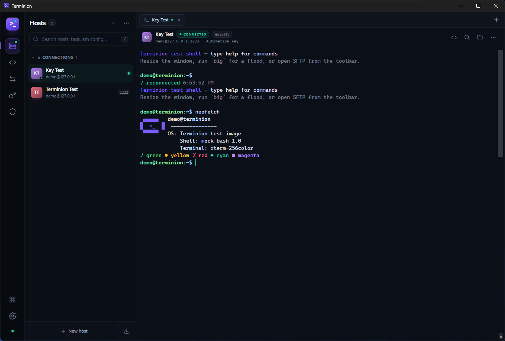
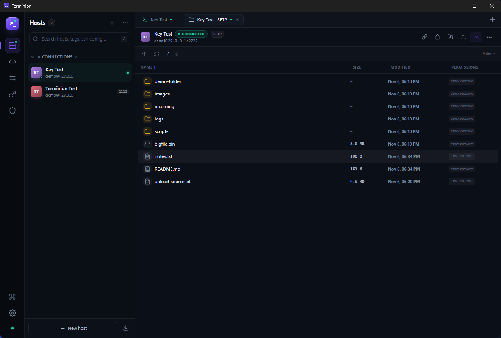
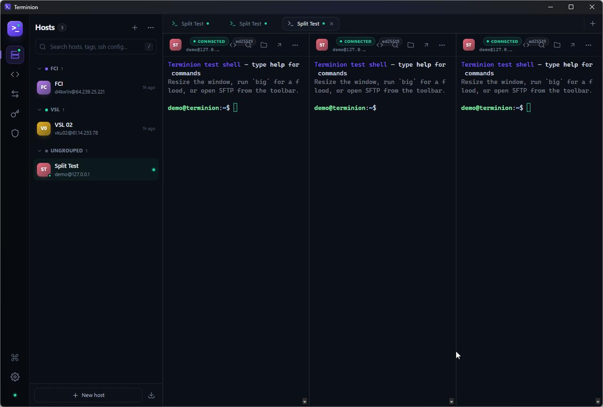
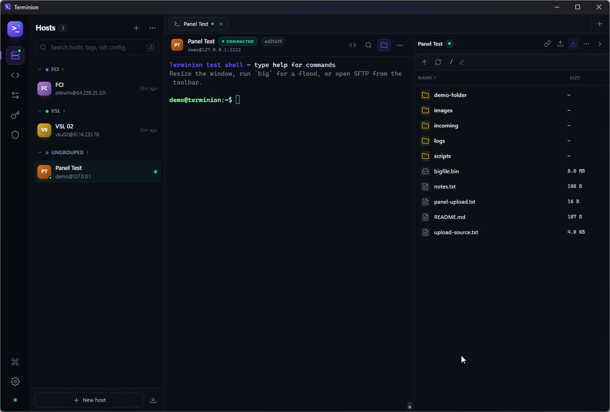
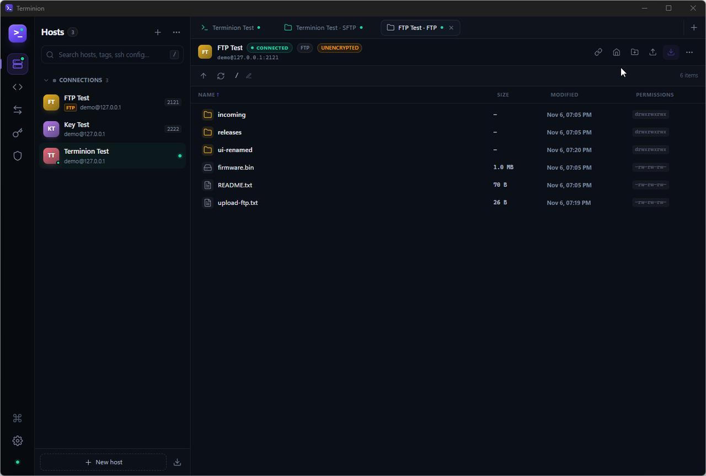

# Terminion

**A fast, local-first SSH, SFTP & FTP workspace for Windows.** A lightweight alternative
to Termius, built with Rust + Tauri and a GPU-rendered terminal.



## Download

The latest private build is available under **Releases**:
[github.com/d4kw1n/terminion/releases/latest](https://github.com/d4kw1n/terminion/releases/latest)

- `Terminion_0.1.2_x64-setup.exe` — per-user installer.
- `Terminion_0.1.2_portable.exe` — portable executable.
- `SHA256SUMS.txt` — checksums for both files.
- `Terminion-CodeSigning.cer` — public certificate for the local self-signed signature.

Both binaries are Authenticode-signed and timestamped. This machine already trusts the
certificate; on a new PC, install the `.cer` into *Trusted Root* and *Trusted Publishers*
only if you trust it. SmartScreen may still warn because the certificate is self-signed.

## Why Terminion

- **Light on memory.** Tauri uses the WebView2 runtime already installed on Windows
  instead of bundling a full Chromium. The native process stays around 5 MB; idle
  sessions add almost nothing. See [Performance](#performance).
- **Native networking.** SSH is implemented in Rust with [`russh`](https://github.com/warp-tech/russh);
  SFTP runs over the same encrypted channel. Legacy plain FTP is supported for old
  appliances. No shelling out to `ssh.exe`, no Node runtime in the middle.
- **Built for flaky networks.** Keepalives, TCP-level probes, automatic reconnect with
  backoff, and a terminal scrollback that survives a reconnect.
- **Local-first by design.** No account, no cloud sync, no telemetry. Credentials are
  sealed with Windows DPAPI on this machine.

## Features

### Hosts and groups



- Unlimited hosts, nested groups, tags, colors, favorites and full-text search.
- **Double-click a host to connect** (a single click only focuses the row).
- Quick connect (`user@host:port`) straight from the sidebar search.
- One-click import of `~/.ssh/config`, including identity files.
- Duplicate, edit, pin, delete, and copy ready-to-use `ssh` commands.
- Automatic group counts, “last used” ordering hints, and live session indicators.
- **OS / distro detection:** on the first successful SSH connection, Terminion identifies
  the remote OS (for example `Ubuntu 24.04.1 LTS`, `Debian GNU/Linux 12`, `macOS 15.1`,
  or `Windows Server 2022`) and shows it on the host row and terminal header. The
  result is cached in the local database; editing the hostname, port, user or protocol
  clears it so the next connection detects the new target.

### Terminals

- Multiple tabs, each a real PTY on the remote machine.
- xterm.js with the WebGL renderer, 256-color truecolor, and selectable themes
  (Terminion, Tokyo Night, Catppuccin, Nord, Gruvbox, Paper Light).
- Search in scrollback (`Ctrl+F`), configurable font, size, cursor, and scrollback.
- Copy/paste (`Ctrl+Shift+C` / `Ctrl+V`), select-to-copy option, right-click menu.
- Unix and Windows servers, keyboard-interactive authentication, startup commands.
- **Split view:** drag a terminal tab onto the left, right, top or bottom edge of another
  terminal pane. Drag more tabs to add panes, including nested splits. The split group is
  preserved when you open or switch to another tab, and **Layout: 2 top + 1 bottom** in a
  split pane's More menu gives the two-over-one arrangement. Every pane keeps its own live
  session (and its own SFTP side panel); the maximize button leaves split mode and focuses
  that terminal.
- **Tab management:** double-click a tab (or use its context menu) to rename it; drag
  tabs horizontally to reorder them. Right-click a tab to create a colored tab group or
  add it to an existing one. Click the group chip to collapse/expand its tabs; right-click
  the chip to rename, recolor, collapse or ungroup.



### Connection resilience

The behaviour that matters on a laptop that moves between networks:

1. **SSH keepalives** detect an idle, dead link (three missed replies by default).
2. **OS TCP keepalive** is enabled on the socket, so a vanished peer is noticed even
   while the SSH stack is blocked on a read.
3. **Automatic reconnect** retries with backoff (0.7s → 8s) and reuses the same tab.
   Terminal scrollback is preserved; a dim `✓ reconnected` marker is appended.
4. **Network-change probes**: when Windows reports the network is back, every open
   session opens a throwaway channel. If the old TCP link is stale, the session
   reconnects immediately instead of waiting for a timeout.
5. **`tmux`/`screen` friendly**: a per-host startup command such as
   `tmux new -A -s work` runs after every reconnect, so the remote process survives too.

Authentication errors and host-key mismatches are treated as fatal and do not loop.

### SFTP file browser

- Browse remote directories with sizes, mtimes, permissions, owners and symlinks.
- Upload files or whole folders from the OS, including native drag & drop.
- Download files or folders recursively; transfers show live speed and progress.
- Create, rename, delete (recursively), change permissions (`chmod`), preview text files.
- Breadcrumb navigation plus an editable path field; sorting by name, size or date.
- Reconnect button and a heartbeat check for stale SFTP channels.
- **Side panel inside the SSH tab:** the folder button in the terminal toolbar opens
  the file browser next to the terminal. Collapse it with the chevron (or the folder
  button) without dropping the SFTP session or an active transfer. Use
  *Open SFTP in new tab* when you want the full-width browser.



- The same browser also speaks **plain FTP** (RFC 959, passive mode) for legacy
  appliances. FTP hosts have no terminal and no `chmod`, and are marked *unencrypted*
  in the UI — prefer SFTP whenever the device supports it.



### Port forwarding

- **Local** forwards (`127.0.0.1:PORT` → service on the server's network).
- **Remote** forwards (server listens and tunnels back to your machine).
- **Dynamic SOCKS5** proxy for pointing browsers and tools through the host.
- Start/stop per rule, optional auto-start on launch, and live status.
- Tunnels share a dedicated SSH connection and reconnect transparently.

### Keys, snippets, known hosts

- Generate Ed25519 keys, import OpenSSH/PEM/PuTTY keys with passphrases.
- Copy public keys, inspect fingerprints, see which hosts use a key.
- Snippets: named commands you can fire into the active terminal from the sidebar,
  terminal toolbar, or command palette.
- Known hosts: trust-on-first-use with blocking on key mismatch; entries can be
  reviewed and removed.

### Interface

- Dark and light themes, five accent colors, native title bar follows the theme.
- Command palette (`Ctrl+K`) for hosts, snippets and every action.
- Native context menus, keyboard navigation, drag & drop, and toast notifications.
- Settings apply instantly to open terminals.

## Keyboard shortcuts

| Shortcut | Action |
| --- | --- |
| `Ctrl+K` / `Ctrl+Shift+P` | Command palette |
| `Ctrl+N` | New host |
| `Ctrl+,` | Settings |
| `Ctrl+B` | Toggle host sidebar |
| `Ctrl+F` | Find in the active terminal |
| `Ctrl+Tab` / `Ctrl+Shift+Tab` | Next / previous tab |
| `Ctrl+W` | Close the active tab |
| `Ctrl+Shift+C` | Copy terminal selection |
| `Ctrl+V` / `Ctrl+Shift+V` | Paste into terminal |
| `/` | Focus host search |

## Architecture

```
┌──────────────────────────────────────────────────────────────┐
│  React + TypeScript UI  (Vite)                               │
│  xterm.js · zustand · Tauri IPC channels                     │
└───────────────▲──────────────────────────────────────────────┘
                │ Channel<TerminalEvent> / invoke()
┌───────────────┴──────────────────────────────────────────────┐
│  Rust backend (Tauri 2)                                      │
│                                                              │
│  TerminalManager ── PTY channels, keepalive, reconnect       │
│  SftpManager ────── SFTP v3, streaming transfers             │
│  FtpManager ─────── plain FTP (RFC 959), streaming transfers │
│  ForwardManager ─── local / remote / SOCKS5 tunnels          │
│  SQLite (WAL) ───── hosts, keys, snippets, known hosts       │
│  DPAPI ──────────── passwords and private keys at rest       │
└───────────────▲──────────────────────────────────────────────┘
                │ russh (pure Rust SSH-2 client)
┌───────────────┴──────────────────────────────────────────────┐
│  Remote servers                                              │
└──────────────────────────────────────────────────────────────┘
```

The backend owns all network state. The frontend only renders terminal bytes and sends
keystrokes, which keeps tab switching instant and avoids duplicating session state.

## Requirements

- Windows 10/11 (WebView2 is bundled with Windows 11 and the installer can bootstrap it
  on Windows 10).
- Node.js 20+ and npm.
- Rust 1.89+ with the MSVC toolchain, plus Visual Studio Build Tools (C++ workload).

## Development

```bash
npm install
npm run app:dev        # Vite + Tauri dev window
```

Build a production binary and installer:

```bash
npm run app:build      # NSIS installer in src-tauri/target/release/bundle/nsis
```

Frontend-only checks:

```bash
npm run build          # tsc --noEmit + vite build
cargo check --manifest-path src-tauri/Cargo.toml
```

## Testing with the local SSH/SFTP server

The repository ships a disposable test server (Python + `asyncssh`):

```bash
python -m pip install asyncssh pyftpdlib
python tools/mock_ssh_server.py
python tools/mock_ftp_server.py
# SSH:  demo / demo @ 127.0.0.1:2222
# FTP:  demo / demo @ 127.0.0.1:2121
# HTTP: http://127.0.0.1:8080  (for port-forward tests)
```

The server provides an interactive shell, SFTP rooted at `tools/mock/sftp-root`,
software-based port forwarding, and a small HTTP target. Add your generated public key
to `tools/mock/authorized_keys` to test key authentication.

## Security notes

A focused source review, including the download path-traversal fix and remaining
protocol trade-offs, is available in [docs/SECURITY-REVIEW.md](docs/SECURITY-REVIEW.md).

- Passwords, private keys and key passphrases are encrypted with **Windows DPAPI**
  (current user scope) before they touch SQLite. Copying the database alone does not
  reveal credentials.
- Plain FTP is unencrypted by design (RFC 959). Credentials and files cross the network
  in the clear; Terminion marks FTP hosts and only offers the protocol for legacy
  devices. Use SSH/SFTP whenever possible.
- Server host keys are verified with trust-on-first-use. A changed key is rejected with
  the saved and presented fingerprints shown; remove the entry in **Known hosts** only
  if the change is expected.
- The Tauri content security policy restricts the webview to local assets and IPC.
- No analytics, crash reporting, update pings or network calls other than the SSH
  connections you configure.

## Design choices

- **SQLite in WAL mode** instead of a JSON file: safe concurrent reads, atomic updates,
  and no full-file rewrites on every keystroke.
- **No Electron.** The release binary is a few MB plus the system WebView2 runtime.
- **Event channels, not events per byte.** Terminal output is batched (12ms / 64KB) and
  base64-encoded before crossing the IPC boundary, so `cat bigfile` does not stall the UI.
- **Low idle overhead.** Keepalives are the only traffic for idle terminals; SFTP
  heartbeat checks run only while a file tab is in the foreground.

## Performance

Measured on the release build (Windows 11, 1280×864 window, x64). “Private working
set” is the memory figure Task Manager reports, summed over the app's process tree:

| State | `terminion.exe` | WebView2 helpers | Total private working set |
| --- | --- | --- | --- |
| Empty workspace | ~4 MB | ~133 MB | ~137 MB |
| Five content tabs open | ~4 MB | ~206 MB | ~210 MB |

The native Rust process is deliberately small; the system WebView2 runtime accounts
for most of the footprint. Idle SSH sessions cost almost nothing because the backend
only exchanges keepalives. Release artifacts: `terminion.exe` ≈ 7.6 MB and the NSIS
installer ≈ 2.9 MB.

A compact **RAM / CPU** readout is available in the top-right corner of the tab bar.
RAM is the private working set of the whole process tree (Terminion + WebView2), and
CPU is normalised across all logical processors and refreshed every two seconds.

## Project layout

```
src/                    React application
  components/           Sidebar, terminal, SFTP, modals, palette
  pages/                Snippets, forwards, keys, known hosts, settings
  lib/                  IPC client, xterm integration, types
src-tauri/src/
  ssh/terminal.rs       PTY sessions, reconnect state machine
  ssh/sftp.rs           SFTP sessions and streaming transfers
  ssh/ftp.rs            Plain FTP sessions and streaming transfers
  ssh/forward.rs        Local/remote/SOCKS5 listeners
  db.rs                 SQLite schema and queries
  secret.rs             DPAPI sealing
tools/mock_ssh_server.py  Local test server (not bundled)
```

## Limitations

- Windows is the primary target; the Tauri/Rust core is portable, but secret storage
  uses DPAPI and the packaging is Windows-first.
- The file browser supports **SFTP** (FTP over SSH) and plain **FTP**. FTPS
  (implicit/explicit TLS) is not implemented yet.
- Cloud sync, team vaults and Mosh are intentionally out of scope; Terminion is a
  local, single-user workspace.

## License

MIT — see [LICENSE](LICENSE).
